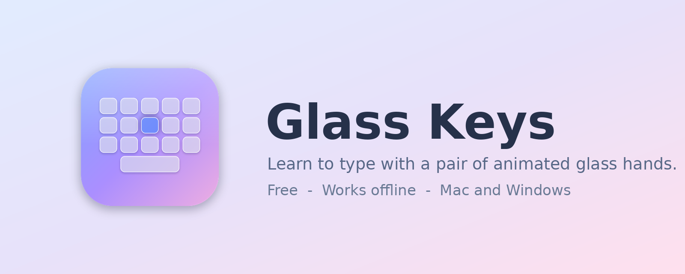
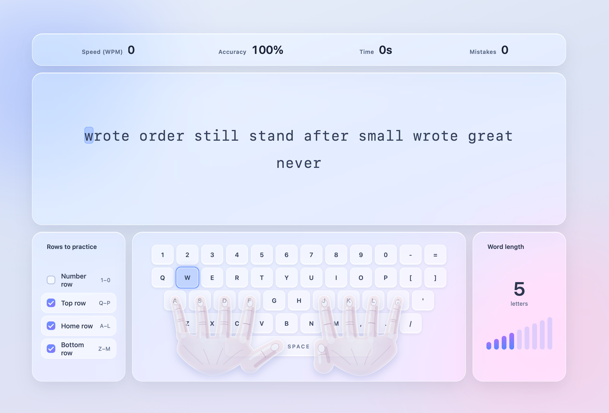

# Glass Keys

**Learn to type with a pair of animated glass hands.**
Free, works with no internet, and nothing you type ever leaves your computer.

- Two see-through hands move to each key as you type
- Practice any rows you like: numbers, top, home or bottom
- Pick your word length with a sound-bar control
- Shows your speed, accuracy and mistakes as you go
   
---

## Download

### 1. Go to the downloads page

**[Click here for the downloads page](../../releases/latest)**, then scroll down to **Assets**.

### 2. Pick the file for your computer

| I use… | Download this file |
|---|---|
| **Windows** | `Glass-Keys-…-windows-setup.exe` |
| **Mac** (Intel or M-chip, both work) | `Glass-Keys-…-mac.dmg` |
| **Something else**, or I don't want to install | `Glass-Keys.html` |

---

## Windows: step by step

1. Download the `windows-setup.exe` file.
2. Double-click it. Glass Keys installs by itself in a few seconds and opens.
3. Next time, open **Start** and type **Glass Keys**.

> **A blue "Windows protected your PC" screen?** That is normal for free apps. Click **More info**, then **Run anyway**.

## Mac: step by step

1. Download the `mac.dmg` file and double-click it.
2. Drag **Glass Keys** into the **Applications** folder.
3. Open **Applications**, then **right-click** Glass Keys and choose **Open**. Click **Open** again.
   You only have to do this the first time.

> **Mac says the app can't be opened?** Open **System Settings → Privacy & Security**, scroll down and click **Open Anyway**.
>
> **Mac says the app is "damaged"?** It isn't. Open **Terminal** and paste this line, then press Enter:
> `xattr -cr /Applications/Glass\ Keys.app`

## The simplest way (any computer, no install)

1. Download `Glass-Keys.html`.
2. Double-click it. It opens in your browser and works with no internet.

---

## I want a real app, not a browser page

The Windows and Mac downloads above are already real apps. They open in their own window with their own icon, are not a browser tab, and need no internet.

If you would rather build the app on your own computer, follow the steps for your system.

### On a Mac

1. Click the green **Code** button at the top of this page, then **Download ZIP**, and double-click the ZIP to unzip it.
2. Open **Terminal** (press **Cmd + Space**, type *Terminal*, press Enter).
3. Type `bash ` (with a space after it), drag the file `scripts/mac/install_glass_keys.sh` from the unzipped folder into the Terminal window, and press **Enter**.
4. If it says the command line tools are missing, run `xcode-select --install`, wait for it to finish, and do step 3 again.
5. Wait about a minute. Glass Keys opens and is saved in the **Applications** folder inside your home folder.

### On Windows

1. Click the green **Code** button at the top of this page, then **Download ZIP**.
2. Right-click the ZIP and choose **Extract All**.
3. Open the extracted folder, then **scripts**, then **windows**.
4. Double-click **Install-Glass-Keys.bat**.
5. A **Glass Keys** icon appears on your Desktop and in the Start menu. Double-click it. It opens in its own window and works with no internet.

---

## Questions

**Does it need the internet?** No. After you download it, it never connects to anything.

**Does it collect my data?** No. Nothing is sent anywhere.

**Is it free?** Yes, completely.

**Something went wrong.** Please open an **Issue** on this page and say which computer you use.

## License

MIT. You are free to use, share and change it. See [LICENSE](LICENSE).
